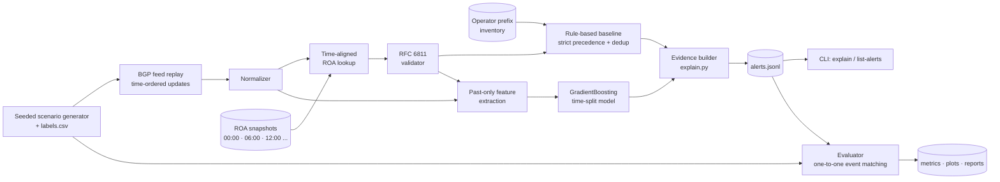

<div align="center">

# 🛰️ Explainable BGP Origin & Subprefix Anomaly Monitor

**PS-005 · AIORI-3 Hackathon · Category: Cyber Security**

*Replay a BGP feed, validate every announcement against time-aligned RPKI ROAs and an operator prefix inventory, and raise alerts that explain exactly why they fired.*


</div>

---

## 📌 Table of Contents

1. [The problem](#-the-problem)
2. [What we built](#-what-we-built)
3. [Results at a glance](#-results-at-a-glance)
4. [Architecture](#-architecture)
5. [How detection works](#-how-detection-works)
6. [Data and labelled scenarios](#-data-and-labelled-scenarios)
7. [Baseline evaluation](#-baseline-evaluation-rule-based)
8. [ML detector](#-ml-detector-added-after-the-baseline)
9. [Leakage audit](#-leakage-audit-and-honesty-checks)
10. [Explainable alerts](#-explainable-alerts)
11. [Quick start](#-quick-start)
12. [Repository layout](#-repository-layout)
13. [Reproducibility](#-reproducibility)
14. [Limitations](#-limitations-stated-plainly)
15. [Requirement compliance](#-requirement-compliance)
16. [References](#-references)

---

## 🎯 The problem

BGP was designed without origin verification. Any network can announce prefixes it does not own, by mistake or on purpose. RPKI Route Origin Authorizations (ROAs) sign prefix-to-ASN mappings, but attackers can still win traffic by announcing **more-specific sub-prefixes** that routers prefer over the broader legitimate route. A legitimate origin ASN can even be **forged**, making the announcement look valid to ROV.

Operators need a monitor that:

- detects **unexpected origins** and **subprefix / more-specific** anomalies,
- uses **ROA snapshots aligned in time** with the feed (no future data),
- tells the analyst **why** each announcement was flagged,
- is measured honestly: precision, recall, alert latency and false positives, including **legitimate** multi-origin and policy-change cases.

## 🧩 What we built

| Component | Description |
|---|---|
| **BGP replay pipeline** | Time-ordered replay of normalized updates `(timestamp, prefix, origin_asn, peer, action)` |
| **Time-aligned ROA store** | For an update at time *t*, uses the latest snapshot at or before *t*. A distinct `NoSnapshot` outcome means it never falls back to a later snapshot |
| **RFC 6811 validator** | `Valid / Invalid / NotFound / NoSnapshot`, with maxLength and AS0 handling and a structured reason for invalidity |
| **Operator prefix inventory** | Exact and longest-prefix-match lookup, IPv4 and IPv6 |
| **Rule-based baseline** | Strict rule precedence, so each update produces at most one alert. Deduplication never suppresses a new origin |
| **Labelled synthetic generator** | Seeded and configurable. Anomalies and hard benign cases, each written to `labels.csv` |
| **ML detector** | One GradientBoosting model, added only **after** the baseline was evaluated, trained with a strict time split |
| **Evidence-based alerts** | JSON alerts with covering ROAs, snapshot time, ROV state, inventory match and a plain-English reason |
| **Evaluation suite** | Event-level one-to-one matching, bootstrap CIs, multi-seed runs, per-scenario recall and false positives |

---

## 📊 Results at a glance

> All numbers come from code (`src/evaluate.py`, `src/train_ml.py`) and are saved in `reports/`. The data is **synthetic**, so read these as how well each detector separates the scenarios we modelled, not as real-world accuracy.

### Rule baseline (generator v2, 92 labelled events)

| Policy | Event Precision | Event Recall | Event F1 |
|---|:---:|:---:|:---:|
| Primary (all operator alert types) | **0.6154** | **0.8000** | **0.6957** |
| Secondary (high and medium severity only) | 0.7273 | 0.8000 | 0.7619 |

Bootstrap 95% CI (over events, primary): precision 0.526 to 0.708, recall 0.675 to 0.925, F1 0.602 to 0.783.

### Rules vs ML on the held-out test slice (3 generator seeds, mean ± std)

| System | Event Precision | Event Recall | Event F1 | Latency (end to end) |
|---|:---:|:---:|:---:|:---:|
| Rules (primary) | 0.5185 | 0.7242 ± 0.0044 | 0.6043 | 0.0145 ms/update |
| Rules (secondary) | 0.6364 | 0.7242 ± 0.0044 | 0.6774 | 0.0145 ms/update |
| **ML alone** | **0.9044 ± 0.0325** | **0.9183 ± 0.0261** | **0.9104 ± 0.0087** | 0.60 ms/update |
| Rules OR ML (primary) | 0.5476 | 0.9183 | 0.6859 | 0.60 ms/update |
| Rules OR ML (secondary) | 0.6476 | 0.9183 | 0.7593 | 0.60 ms/update |

### The headline finding

| Forged-origin more-specific attack (ROV **Valid**, origin **in inventory**) | Recall |
|---|:---:|
| Rule baseline | **0.0%** |
| ML detector | **≈ 81%** |

Forged-origin attacks pass both RFC 6811 and the inventory check, and detecting them without AS_PATH analysis is inherently hard. The rules cannot see them by design. ML recovers most of them from feed metadata alone (new peer for this prefix and origin, origin rarity, update behaviour), at a measurable false-positive cost on traffic-engineering events.

<div align="center">
  
  <br><sub>Baseline vs ML vs Hybrid on the held-out test slice</sub>
</div>

---

## 🏗️ Architecture



**Design principles**

- **Baseline first.** The ML model was added only after the rule baseline was evaluated and its metrics saved.
- **No future leakage.** ROA lookup uses snapshots at or before the update time. ML features use past data only. Train, validation and test are split by time.
- **Explainability by construction.** Every alert carries the data that triggered it.
- **Honest evaluation.** One-to-one event matching, benign hard cases that *should* trigger false positives, and a leakage audit.

---

## 🔍 How detection works

### RFC 6811 route origin validation

| State | Condition |
|---|---|
| **Valid** | At least one covering ROA matches the origin ASN **and** prefix length ≤ maxLength |
| **Invalid** | Covering ROAs exist but none match (`origin_mismatch`, `length_exceeds_maxlength`, `as0_roa`, or a combination) |
| **NotFound** | No covering ROA |
| **NoSnapshot** | No ROA snapshot exists at or before the update time (never falls back to a later snapshot) |

AS0 ROAs can never match. A route covered only by AS0 ROAs is Invalid.

### Baseline rule precedence (at most one alert per update)

| Precedence | Alert type | Condition | Severity |
|:---:|---|---|:---:|
| 0 | *(no alert)* | Withdrawal, or authorized origin with ROV Valid, or background route with Valid / NotFound | none |
| 1 | `ORIGIN_HIJACK` | Exact inventory prefix, origin not in inventory, ROV Invalid / NotFound | high |
| 2 | `SUBPREFIX_HIJACK` | More-specific of an inventory / ROA prefix, unauthorized origin, ROV Invalid / NotFound | high |
| 3 | `INVENTORY_MISMATCH` | Inventory prefix, origin not in inventory, **but ROV Valid** (config drift, not an attack) | low |
| 4 | `ROA_INVALID` | Origin in inventory but ROV Invalid (ROA lags a policy change) | medium |
| 5 | `ROA_MISSING` | Inventory-owned prefix with ROV NotFound | low |
| , | `THIRD_PARTY_INVALID` | RPKI-invalid route **outside** the inventory (internet hygiene noise, reported separately, excluded from operator precision) | low |

**Deduplication** is keyed on `(prefix, origin_asn)` within a configurable window. A **new origin on the same prefix is never suppressed**, and the first-seen time is preserved for latency measurement.

---

## 🧪 Data and labelled scenarios

Everything is generated by a seeded, YAML-configurable generator (`src/inject.py`). Every injected event is written to `labels.csv` with its scenario, difficulty and expected alert type.

### Anomalies (`benign = false`)

| Scenario | Difficulty | What it models |
|---|:---:|---|
| `exact_origin_hijack` | easy | Foreign ASN announces an inventory prefix |
| `subprefix_hijack` | easy | Foreign ASN announces a more-specific inside an inventory prefix |
| `hijack_after_roa_change` | hard | Hijack minutes after a ROA snapshot change (tests time alignment) |
| `loose_maxlength_hijack` | hard | **Forged-origin** more-specific using the legitimate ASN within maxLength (ROV Valid, origin in inventory) |

### Legitimate hard cases (`benign = true`)

| Scenario | What it models |
|---|---|
| `multi_origin_anycast` | Two or more legitimate origins, all authorized |
| `multi_origin_ddos_scrubbing` | Provider ASN authorized by ROA but missing from the inventory |
| `policy_change_roa_first` | ROA published before the new origin announces |
| `policy_change_roa_lag_inventory_updated` | New origin announces before the ROA catches up; inventory is current |
| `policy_change_roa_lag_inventory_stale` | New origin announces before the ROA catches up; inventory is stale |
| `te_more_specific` | Legitimate traffic-engineering more-specifics within maxLength |

Plus background traffic across many peers and origins, including about 1.5% third-party RPKI-invalid routes.

| Dataset | Purpose | Scale |
|---|---|---|
| **Baseline dataset** (`config.yaml`) | Rule baseline evaluation | 3,164 updates · 92 events (40 anomalies, 52 benign) |
| **ML dataset** (`config_ml.yaml`) | Time-split ML training and comparison | 10× scale, 1,020 labelled events. This is a **scale change, not a scenario change** |

The ML dataset uses its own inventory and ROA snapshots (`data/ml_inventory.csv`, `data/ml_roa_snapshots/`), so the baseline stays reproducible.

---

## 📏 Baseline evaluation (rule-based)

Event-level, one-to-one matching of alerts to labelled events. Event-level precision is the headline metric because incidents are event windows.

<div align="center">
  
  
</div>

### Recall per anomaly scenario

| Scenario | Difficulty | Recall |
|---|:---:|:---:|
| `exact_origin_hijack` | easy | 100% (12/12) |
| `subprefix_hijack` | easy | 100% (12/12) |
| `hijack_after_roa_change` | hard | 100% (8/8) |
| `loose_maxlength_hijack` | hard | **0% (0/8)**, a genuine gap that motivates ML |
| **Easy / Hard / Overall** | | 100% / 50% / 80% |

### False positives on legitimate scenarios (primary policy)

| Benign scenario | Events flagged | Alert type |
|---|:---:|---|
| `multi_origin_anycast` | 0 / 10 | none |
| `policy_change_roa_first` | 0 / 8 | none |
| `te_more_specific` | 0 / 14 | none |
| `multi_origin_ddos_scrubbing` | 8 / 8 | `INVENTORY_MISMATCH` (low) |
| `policy_change_roa_lag_inventory_updated` | 6 / 6 | `ROA_INVALID` (medium) |
| `policy_change_roa_lag_inventory_stale` | 6 / 6 | `ORIGIN_HIJACK` (high) |
| Background operator traffic | 0.0 FP per 1,000 updates | none |

The three hard benign scenarios are flagged **by construction**. They exist to show where ROA and inventory update at different speeds from announcements, so the 61.5% precision reflects our scenario mix, not a real-world false-positive rate.

<div align="center">
  
  
</div>

**Throughput:** about 0.0145 ms per update (roughly 70,000 updates per second). Replay-time alert latency is 0 s because alerts fire on arrival, so wall-clock processing time is the meaningful latency figure.

---

## 🤖 ML detector (added after the baseline)

One `GradientBoostingClassifier`, trained with a chronological split (60% train / 20% validation / 20% test). The decision threshold τ\* = 0.05 was chosen on the **validation** slice only. Every slice contains every scenario and at least 20 forged-origin events.

**Features (all computed from past data only)**: RFC 6811 state, origin-in-inventory, prefix-length delta vs parent, origin-new-for-prefix, peer-new-for-prefix-origin, more-specific-first-seen, prefix age (capped at 6 h), origin rarity, update rate over 30 minutes, hour of day. No raw prefixes, ASNs or event IDs are used.

<div align="center">
  
  
</div>

### Recall by anomaly scenario (test slice)

| Scenario | Rules | ML | Rules OR ML |
|---|:---:|:---:|:---:|
| `exact_origin_hijack` | 100% | 100% | 100% |
| `subprefix_hijack` | 100% | 100% | 100% |
| `hijack_after_roa_change` | 100% | 100% | 100% |
| `loose_maxlength_hijack` (forged origin) | **0%** | **80.95%** | **80.95%** |

### False positives on legitimate scenarios (test slice)

| Benign scenario | Rules (primary) | ML alone |
|---|:---:|:---:|
| `multi_origin_anycast` | 0 / 26 | 1 / 26 |
| `multi_origin_ddos_scrubbing` | 20 / 20 | **0 / 20** |
| `policy_change_roa_first` | 0 / 20 | 0 / 20 |
| `policy_change_roa_lag_inventory_stale` | 16 / 17 | **3 / 17** |
| `policy_change_roa_lag_inventory_updated` | 16 / 17 | **0 / 17** |
| `te_more_specific` | 0 / 18 | **8 / 18** |

**Trade-off in plain terms.** ML removes most false positives from DDoS scrubbing and policy-lag cases and recovers forged-origin attacks, but it introduces false positives on traffic-engineering more-specifics (8 / 18) because peer novelty overlaps between attacks and TE events. ML also costs about 40× the per-update latency of the rules (0.60 ms vs 0.0145 ms, measured end to end, one update at a time). Rules OR ML recovers recall but inherits the rules' false positives, so **ML alone is the best option on this data**.

---

## 🛡️ Leakage audit and honesty checks

We treated a perfect score as a warning sign. The ML dataset went through an audit, and the earlier results are preserved in `reports/`.

| Version | What happened | Preserved in |
|---|---|---|
| ML v1 | Precision, recall and F1 all 1.0. The generator leaked: attacks came almost only from a novel peer and the forged origin never appeared in benign traffic | `reports/ml_metrics_v1.json` (reconstructed from the Phase 5 report) |
| ML v2 (leaky) | Single features still near-perfect, and test slices were missing hard scenarios | `reports/ml_metrics_v2_leaky.json` |
| **ML v3 (current)** | Per-update peer randomisation, legitimate AS64510 carrier traffic, disjoint subprefix pools, capped prefix age, every scenario in every slice | `reports/ml_dataset_v3_changelog.md` |

<div align="center">
  
</div>

- **Shuffled-label control** (20 permutations, test AUC): mean **0.5522**, std **0.1954**, min 0.157, max 0.844. The mean is near chance, but the spread is large because positives are clustered in a small slice. This shows **no systematic leakage on average**. It does not prove leakage is absent.
- **Known residual limit:** `peer_new_for_prefix_origin` has a single-feature AUC of **0.893**, above our ~0.85 goal. We report it rather than hide it.
- **Seeds 777 / 888 / 999** measure variance across synthetic datasets from one generator. They are **not** external validity.
- The rule baseline was also audited. Post-baseline generator edits that had hidden background noise were caught, disclosed and preserved in `reports/baseline_v1_raw.txt`.

---

## 🧾 Explainable alerts

Every alert, from either detector, is one JSON line in `reports/alerts.jsonl` with deterministic IDs (re-running produces identical output).

**Rule alerts** state which rule fired and why earlier rules in the precedence table did not. **ML alerts** add the score, the threshold and the top three contributing features, computed as per-feature contribution against a training-set background mean, labelled as a non-causal model attribution.

<details>
<summary><b>Example: ML alert on a forged-origin more-specific (true positive)</b></summary>

```json
{
  "alert_id": "alt-ml-7a7b0b3b",
  "type": "ML_ANOMALY",
  "prefix": "198.19.35.0/24",
  "origin_asn": 64510,
  "detector": "ml",
  "score": 0.1977,
  "threshold": 0.05,
  "evidence": {
    "covering_roas": [{"prefix": "198.18.0.0/15", "asn": 64510, "maxLength": 24}],
    "rfc6811_state": "Valid",
    "inventory_match": {
      "prefix": "198.18.0.0/15",
      "owner": "Enterprise Campus",
      "allowed_origins": [64510]
    },
    "peer": "206.108.34.1",
    "top_contributing_features": [
      {"feature": "update_rate_30m", "value": 0.0, "direction": "+"},
      {"feature": "origin_rarity", "value": 0.0004, "direction": "+"},
      {"feature": "peer_new_for_prefix_origin", "value": 1.0, "direction": "+"}
    ],
    "explanation_method": "Per-feature contribution against empirical background mean (non-causal attribution)"
  }
}
```
ROV says **Valid** and the origin is authorized, so the rules stay silent. The ML detector flags it because the announcement arrives via a peer that has never carried this origin for this prefix.

</details>

<details>
<summary><b>Example: ML false positive on a benign policy-lag event</b></summary>

```json
{
  "alert_id": "alt-ml-cea5731c",
  "type": "ML_ANOMALY",
  "prefix": "203.0.113.0/24",
  "origin_asn": 64497,
  "score": 0.9676,
  "evidence": {
    "rfc6811_state": "Invalid",
    "invalid_reason": "origin_mismatch",
    "inventory_match": {"prefix": "203.0.113.0/24", "owner": "Regional-ISP-Alpha", "allowed_origins": [64496]},
    "top_contributing_features": [
      {"feature": "rov_state_encoded", "value": 2.0},
      {"feature": "origin_rarity", "value": 0.2},
      {"feature": "peer_new_for_prefix_origin", "value": 1.0}
    ]
  }
}
```
Shown deliberately: the ROA lags a legitimate policy change, so the announcement is RPKI-invalid and looks suspicious. This is the kind of case an analyst has to review.

</details>

### Inspect alerts from the CLI

```bash
python -m src.cli list-alerts --type ORIGIN_HIJACK --severity high
python -m src.cli explain --alert-id alt-ml-7a7b0b3b
```

---

## 🚀 Quick start

```bash
git clone https://github.com/<org>/<team-name>.git
cd <team-name>

python -m venv .venv
# Windows: .venv\Scripts\activate    macOS/Linux: source .venv/bin/activate
pip install -r requirements.txt

python -m pytest -q                 # run the test suite
python -m src.evaluate              # rule baseline evaluation -> reports/baseline_*.json + plots
python -m src.train_ml              # ML dataset, training, audit, comparison -> reports/ml_*.json, comparison.md
python -m src.explain               # build evidence-based alerts -> reports/alerts.jsonl
python -m src.cli list-alerts       # browse alerts
```

No network access is required. The core demo runs entirely on the committed synthetic data.

## 🗂️ Repository layout

```text
.
├── config.yaml                 # baseline dataset, windows, seeds
├── config_ml.yaml              # ML dataset (10x scale, own inventory and ROAs)
├── requirements.txt
├── data/
│   ├── inventory.csv           # operator prefix inventory (baseline)
│   ├── roa_snapshots/          # time-stamped ROA snapshots (baseline)
│   ├── feed_replay.csv         # normalized replay feed with injected events
│   ├── labels.csv              # ground-truth labels, scenario, difficulty
│   ├── manifest.json           # generator version, seed, counts
│   ├── ml_inventory.csv · ml_roa_snapshots/ · ml_feed_replay.csv · ml_labels*.csv
├── src/
│   ├── replay.py               # time-ordered replay and loaders
│   ├── roa_store.py            # time-aligned ROA lookup
│   ├── inventory.py            # exact and longest-prefix-match lookup
│   ├── rov.py                  # RFC 6811 validation with rich result
│   ├── rules.py                # rule-based baseline, precedence, dedup
│   ├── inject.py               # seeded labelled anomaly and benign generator
│   ├── evaluate.py             # event-level metrics, bootstrap CI, multi-seed
│   ├── features.py             # past-only feature extraction
│   ├── train_ml.py             # time-split model, leakage audit, comparison
│   ├── explain.py              # evidence builder and alert writer
│   └── cli.py                  # explain / list-alerts
├── tests/                      # 84 tests
├── reports/                    # metrics JSON, plots, comparison.md, alerts.jsonl, changelogs
└── docs/                       # presentation and report
```

## ♻️ Reproducibility

- All randomness is seeded. Seeds are recorded in `data/manifest.json` and `data/ml_manifest*.json`.
- Re-running `python -m src.evaluate` is idempotent: alert IDs are deterministic and wall-clock timings are written to a separate file (`reports/baseline_timing.json`).
- Per-seed ML feeds (`data/ml_feed_seed_*.csv`) are gitignored and regenerated by `python -m src.train_ml` (seeds 777, 888, 999).
- Every number in this README is produced by code and saved under `reports/`.

---

## ⚠️ Limitations (stated plainly)

- **All data is synthetic.** Results show how separable our modelled scenarios are, not accuracy on real operator feeds. Real BGP feeds will be noisier.
- **Forged-origin detection without AS_PATH is inherently limited.** ML recovers about 81% using feed metadata alone and adds false positives on TE events.
- **Hard benign scenarios are flagged by construction**, so baseline precision reflects our scenario mix.
- **A residual separability limit remains** (`peer_new_for_prefix_origin`, AUC 0.893), and the shuffled-label control has a wide spread (std 0.195) on a small test slice.
- **Latency:** replay-time alert latency is near zero by construction. We report wall-clock processing time instead.

## ✅ Requirement compliance

| Requirement | Status |
|---|:---:|
| One replayed BGP feed with matching ROA snapshots | ✅ |
| Detect unexpected-origin and subprefix / more-specific anomalies | ✅ |
| Labelled synthetic anomaly events | ✅ |
| Rule-based baseline implemented and evaluated first | ✅ |
| One ML model added only after baseline evaluation | ✅ |
| Legitimate multi-origin and policy-change scenarios tested for false positives | ✅ |
| Precision, recall, alert latency and false positives reported | ✅ |
| Evidence-based alerts explaining each detection | ✅ |
| **No** automatic blocking, blackholing or full AS_PATH analysis | ✅ (none implemented) |

## 📚 References

- RFC 6811: *BGP Prefix Origin Validation*. <https://www.rfc-editor.org/rfc/rfc6811.html>

---

<div align="center">

**Team:** `<team-name>` · **Members:** `<names>` · **Mentors:** AIORI-3 / `aiori-hackathon`

*AIORI-3 · PS-005 · Explainable BGP Origin and Subprefix Anomaly Monitor*

</div>
