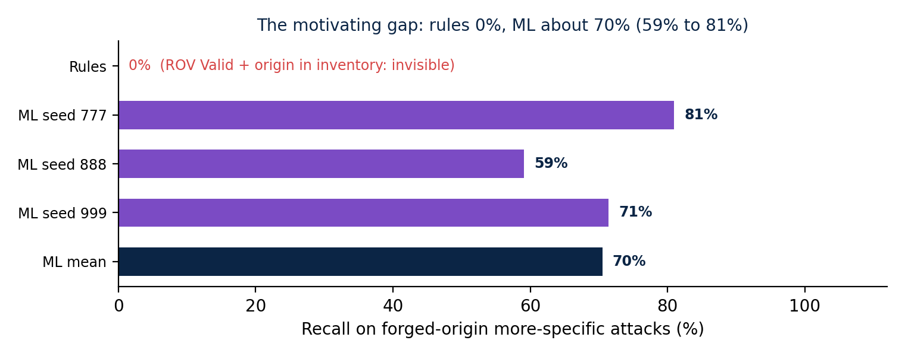
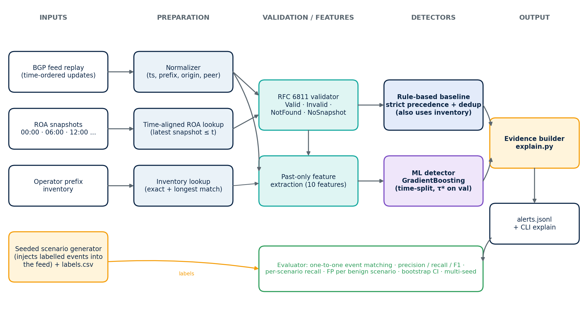
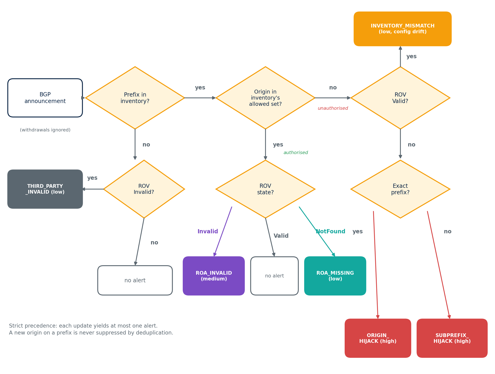
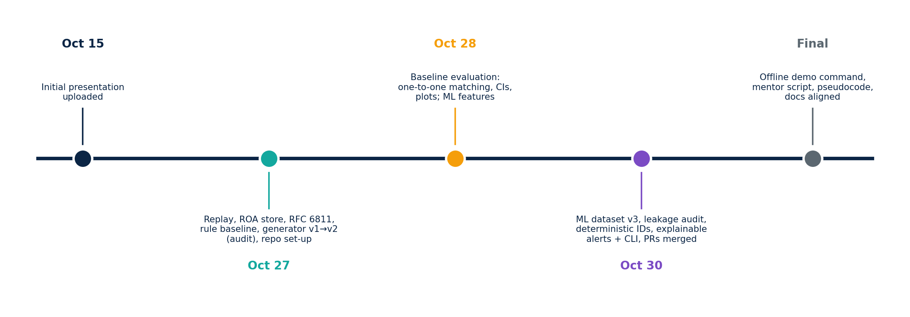

<div align="center">

# 🛰️ ThirdEye · Explainable BGP Origin & Subprefix Anomaly Monitor

**AIORI-3 Hackathon · PS-005 · Category: Cyber Security**

*Replay a BGP feed, validate every announcement against time-aligned RPKI ROAs and an operator prefix inventory, and raise alerts that explain exactly why they fired.*


[](docs/report.pdf)

[**📄 Report**](docs/report.pdf) · [**🎬 Demo script**](docs/demo_script.md) · [**📐 Pseudocode**](docs/pseudocode.md) · [**🚀 Quick start**](#-quick-start)

</div>

---

## ⚡ At a glance

| 🎯 Rule baseline F1 | 🤖 ML detector F1 | 🕳️ Forged-origin recall | ✅ Tests |
|:---:|:---:|:---:|:---:|
| **0.6957** | **0.9104 ± 0.0087** | rules **0%** → ML **≈ 70%** *(59–81% across 3 seeds)* | **100** passing |

> Every number in this README is produced by code in this repository and saved under `reports/`. The data is **synthetic**, so read the results as *how well each detector separates the scenarios we modelled*, not as real-world accuracy. See [Limitations](#-limitations-stated-plainly).

---

## 📌 Contents

1. [The problem](#-the-problem)
2. [What we built](#-what-we-built)
3. [Results](#-results)
4. [Architecture](#-architecture)
5. [How detection works](#-how-detection-works)
6. [Data and labelled scenarios](#-data-and-labelled-scenarios)
7. [Baseline evaluation](#-baseline-evaluation-rule-based)
8. [ML detector](#-ml-detector-added-after-the-baseline)
9. [Leakage audit and honesty checks](#-leakage-audit-and-honesty-checks)
10. [Explainable alerts](#-explainable-alerts)
11. [Live demonstration](#-live-demonstration)
12. [Dashboard](#-dashboard-optional)
13. [Quick start](#-quick-start)
14. [Repository layout](#-repository-layout)
15. [Reproducibility](#-reproducibility)
16. [Limitations](#-limitations-stated-plainly)
17. [Requirement compliance](#-requirement-compliance)
18. [Project journey](#-project-journey)
19. [References](#-references)

---

## 🎯 The problem

BGP was designed without origin verification: any network can announce prefixes it does not own, by mistake or on purpose. RPKI Route Origin Authorizations (ROAs) sign prefix-to-ASN mappings, but gaps remain:

- **Subprefix hijacks.** Routers prefer the longest match, so a /24 announced inside a legitimate /22 wins traffic, and a loose ROA `maxLength` can even authorise it.
- **Forged-origin attacks.** The attacker uses the *legitimate* origin ASN, so the announcement is RPKI-Valid and passes inventory checks.
- **Legitimate change looks like an attack.** Anycast, DDoS-scrubbing providers and policy changes (ROA or inventory lagging an announcement) trigger naive detectors.
- **Alerts without evidence** cannot be triaged, and **detectors without honest false-positive measurement** cannot be trusted.

**Scope (per the problem statement):** a rule-based baseline first, then one ML model; **no** automatic route blocking, blackholing or full AS_PATH analysis.

## 🧩 What we built

| Component | Description |
|---|---|
| **BGP replay pipeline** | Time-ordered replay of normalized updates `(timestamp, prefix, origin_asn, peer, action)` |
| **Time-aligned ROA store** | For an update at time *t*, uses the latest snapshot at or before *t*. A distinct `NoSnapshot` outcome means it never falls back to a later snapshot |
| **RFC 6811 validator** | `Valid / Invalid / NotFound / NoSnapshot`, with maxLength and AS0 handling and a structured reason for invalidity |
| **Operator prefix inventory** | Exact and longest-prefix-match lookup, IPv4 and IPv6 |
| **Rule-based baseline** | Strict precedence, at most one alert per update, deduplication that never suppresses a new origin |
| **Labelled scenario generator** | Seeded, YAML-configurable; anomalies **and** legitimate hard cases, all written to `labels.csv` |
| **ML detector** | One GradientBoosting model, added only **after** the baseline was evaluated; past-only features; chronological split |
| **Evidence-based alerts** | JSON alerts with covering ROAs, snapshot time, ROV state, inventory match, peer and a plain-English reason |
| **Evaluation suite** | One-to-one event matching, bootstrap CIs, multi-seed runs, per-scenario recall, false positives per benign scenario |
| **CLI and offline demo** | `explain`, `list-alerts` and a `demo` command that streams alerts live with ground-truth tags |

---

## 📊 Results

### Rule baseline (baseline dataset: 3,164 updates, 92 labelled events)

| Policy | Event Precision | Event Recall | Event F1 |
|---|:---:|:---:|:---:|
| Primary (all operator alert types) | **0.6154** | **0.8000** | **0.6957** |
| Secondary (high and medium severity only) | 0.7273 | 0.8000 | 0.7619 |

Bootstrap 95% CI over events (primary): precision 0.526–0.708 · recall 0.675–0.925 · F1 0.602–0.783.

### Rules vs ML on the held-out test slice (3 generator seeds, mean ± std)

| System | Event Precision | Event Recall | Event F1 | Latency (end to end) |
|---|:---:|:---:|:---:|:---:|
| Rules (primary) | 0.5185 | 0.7242 ± 0.0044 | 0.6043 | 0.0145 ms/update |
| Rules (secondary) | 0.6364 | 0.7242 ± 0.0044 | 0.6774 | 0.0145 ms/update |
| **ML alone** | **0.9044 ± 0.0325** | **0.9183 ± 0.0261** | **0.9104 ± 0.0087** | 0.60 ms/update |
| Rules OR ML (primary) | 0.5476 | 0.9183 | 0.6859 | 0.60 ms/update |
| Rules OR ML (secondary) | 0.6476 | 0.9183 | 0.7593 | 0.60 ms/update |

### 🕳️ The headline finding: the forged-origin gap

A forged-origin more-specific is **RPKI-Valid** and the origin is **in the inventory**, so the rules cannot see it by design. The ML detector recovers most of them from feed metadata alone.

<div align="center">
  
</div>

| Seed | Threshold τ\* (chosen on validation) | Forged-origin recall |
|:---:|:---:|:---:|
| 777 | 0.05 | 80.95% (17 / 21) |
| 888 | 0.07 | 59.09% (13 / 22) |
| 999 | 0.09 | 71.43% (15 / 21) |
| **Rules** | n/a | **0%** |

**Reading it honestly:** about **70%** across three seeds, with a wide range (59–81%), at a measurable false-positive cost on traffic-engineering events. Detecting forged-origin attacks without AS_PATH analysis is inherently limited.

<div align="center">
  
  <br><sub>Baseline vs ML vs Hybrid on the held-out test slice</sub>
</div>

---

## 🏗️ Architecture

<div align="center">
  
</div>

**Design principles**

- **Baseline first.** The ML model was added only after the rule baseline was evaluated and its metrics saved.
- **No future leakage.** ROA lookup uses snapshots at or before the update time; ML features use past data only; data is split chronologically.
- **Explainability by construction.** Evidence is collected while the decision is made, not reconstructed afterwards.
- **Honest evaluation.** One-to-one event matching, benign hard cases that *should* trigger false positives, a leakage audit, and a preserved audit trail.

---

## 🔍 How detection works

### RFC 6811 route origin validation

| State | Condition |
|---|---|
| **Valid** | At least one covering ROA matches the origin ASN **and** prefix length ≤ maxLength |
| **Invalid** | Covering ROAs exist but none match (`origin_mismatch`, `length_exceeds_maxlength`, `as0_roa`, or a combination) |
| **NotFound** | No covering ROA |
| **NoSnapshot** | No ROA snapshot exists at or before the update time |

AS0 ROAs can never match: a route covered only by AS0 ROAs is Invalid. An announcement that precedes the first snapshot is rated **low** severity with the reason *"ROV could not be evaluated: no ROA snapshot at or before this time"*.

### Rule precedence (at most one alert per update)

<div align="center">
  
</div>

| # | Alert type | Condition | Severity |
|:---:|---|---|:---:|
| 0 | *(no alert)* | Withdrawal; authorised origin with ROV Valid; background route with Valid / NotFound | none |
| 1 | `ORIGIN_HIJACK` | Exact inventory prefix, origin not in inventory, ROV Invalid / NotFound | high |
| 2 | `SUBPREFIX_HIJACK` | More-specific of an inventory / ROA prefix, unauthorised origin, ROV Invalid / NotFound | high |
| 3 | `INVENTORY_MISMATCH` | Origin not in inventory **but ROV Valid** (configuration drift, not an attack) | low |
| 4 | `ROA_INVALID` | Origin in inventory but ROV Invalid (ROA lags a policy change) | medium |
| 5 | `ROA_MISSING` | Inventory-owned prefix with ROV NotFound | low |
| , | `THIRD_PARTY_INVALID` | RPKI-invalid route **outside** the inventory; reported separately and excluded from operator precision | low |

**Deduplication** is keyed on `(prefix, origin_asn)` within a configurable window. A **new origin on the same prefix is never suppressed**, and the first-seen time is kept for latency measurement.

---

## 🧪 Data and labelled scenarios

Everything is generated by a seeded, YAML-configurable generator (`src/inject.py`). Every injected event is written to `labels.csv` with its scenario, difficulty and expected alert type.

**Anomalies (`benign = false`)**

| Scenario | Difficulty | What it models |
|---|:---:|---|
| `exact_origin_hijack` | easy | Foreign ASN announces an inventory prefix |
| `subprefix_hijack` | easy | Foreign ASN announces a more-specific inside an inventory prefix |
| `hijack_after_roa_change` | hard | Hijack minutes after a ROA snapshot change (tests time alignment) |
| `loose_maxlength_hijack` | hard | **Forged-origin** more-specific: legitimate ASN, within maxLength, ROV Valid |

**Legitimate hard cases (`benign = true`)**

| Scenario | What it models |
|---|---|
| `multi_origin_anycast` | Two or more legitimate, authorised origins |
| `multi_origin_ddos_scrubbing` | Provider ASN authorised by ROA but missing from the inventory |
| `policy_change_roa_first` | ROA published before the new origin announces |
| `policy_change_roa_lag_inventory_updated` | New origin announces before the ROA catches up; inventory is current |
| `policy_change_roa_lag_inventory_stale` | New origin announces before the ROA catches up; inventory is stale |
| `te_more_specific` | Legitimate traffic-engineering more-specifics within maxLength |

Plus background traffic across many peers and origins, including about 1.5% third-party RPKI-invalid routes.

| Dataset | Purpose | Scale |
|---|---|---|
| **Baseline** (`config.yaml`) | Rule baseline evaluation | 3,164 updates · 92 events (40 anomalies, 52 benign) |
| **ML** (`config_ml.yaml`) | Time-split ML training and comparison | 10× scale · 1,020 labelled events · own inventory and ROA snapshots. A **scale change, not a scenario change** |

---

## 📏 Baseline evaluation (rule-based)

Event-level, one-to-one matching of alerts to labelled events. Event-level precision is the headline metric because incidents are event windows.

<div align="center">
  
  
</div>

**Recall per anomaly scenario**

| Scenario | Difficulty | Recall |
|---|:---:|:---:|
| `exact_origin_hijack` | easy | 100% (12/12) |
| `subprefix_hijack` | easy | 100% (12/12) |
| `hijack_after_roa_change` | hard | 100% (8/8) |
| `loose_maxlength_hijack` | hard | **0% (0/8)** — a genuine gap that motivates the ML model |
| **Easy / Hard / Overall** | | 100% / 50% / 80% |

**False positives on legitimate scenarios (primary policy)**

| Benign scenario | Events flagged | Alert type |
|---|:---:|---|
| `multi_origin_anycast` | 0 / 10 | none |
| `policy_change_roa_first` | 0 / 8 | none |
| `te_more_specific` | 0 / 14 | none |
| `multi_origin_ddos_scrubbing` | 8 / 8 | `INVENTORY_MISMATCH` (low) |
| `policy_change_roa_lag_inventory_updated` | 6 / 6 | `ROA_INVALID` (medium) |
| `policy_change_roa_lag_inventory_stale` | 6 / 6 | `ORIGIN_HIJACK` (high) |
| Background operator traffic | 0.0 FP per 1,000 updates | none |

The three hard benign scenarios are flagged **by construction**: they show where ROA and inventory update at different speeds from announcements. The 61.5% precision therefore reflects our scenario mix, not a real-world false-positive rate.

<div align="center">
  
  
</div>

**Throughput:** about 0.0145 ms per update (roughly 70,000 updates per second). Replay-time alert latency is 0 s because alerts fire on arrival, so wall-clock processing time is the meaningful latency figure.

---

## 🤖 ML detector (added after the baseline)

One `GradientBoostingClassifier`, trained on a chronological split (60% train / 20% validation / 20% test). The decision threshold τ\* is chosen on the **validation** slice only. Every slice contains every scenario and at least 20 forged-origin events.

**Features (all computed from past data only):** RFC 6811 state, origin-in-inventory, prefix-length delta vs parent, origin-new-for-prefix, **peer-new-for-prefix-origin**, more-specific-first-seen, prefix age (capped at 6 h), origin rarity, update rate over 30 minutes, hour of day. No raw prefixes, ASNs or event IDs are used, and labels never come from rule outputs.

<div align="center">
  
  
</div>

**Recall by anomaly scenario (test slice, seed 777)**

| Scenario | Rules | ML | Rules OR ML |
|---|:---:|:---:|:---:|
| `exact_origin_hijack` | 100% | 100% | 100% |
| `subprefix_hijack` | 100% | 100% | 100% |
| `hijack_after_roa_change` | 100% | 100% | 100% |
| `loose_maxlength_hijack` (forged origin) | **0%** | **80.95%** | **80.95%** |

*Seed 777 is the best of the three seeds for forged-origin recall; the 3-seed figure is about 70% (see above).*

**False positives on legitimate scenarios (test slice, seed 777)**

| Benign scenario | Rules (primary) | ML alone |
|---|:---:|:---:|
| `multi_origin_anycast` | 0 / 26 | 1 / 26 |
| `multi_origin_ddos_scrubbing` | 20 / 20 | **0 / 20** |
| `policy_change_roa_first` | 0 / 20 | 0 / 20 |
| `policy_change_roa_lag_inventory_stale` | 16 / 17 | **3 / 17** |
| `policy_change_roa_lag_inventory_updated` | 16 / 17 | **0 / 17** |
| `te_more_specific` | 0 / 18 | **8 / 18** |

**Trade-off in plain terms.** ML removes most false positives from DDoS-scrubbing and policy-lag cases and recovers forged-origin attacks, but it adds false positives on traffic-engineering more-specifics (8 / 18) because peer novelty overlaps between attacks and TE events. It also costs about 40× the per-update latency of the rules (0.60 ms vs 0.0145 ms, measured end to end, one update at a time). Rules OR ML restores recall but inherits the rules' false positives, so **ML alone is the best option on this data**.

---

## 🛡️ Leakage audit and honesty checks

We treated a perfect score as a warning sign. The ML dataset went through an audit, and every earlier run is preserved in `reports/`.

| Version | What happened | Preserved in |
|---|---|---|
| ML v1 | Precision, recall and F1 all 1.0. The generator leaked: attacks came almost only from a novel peer and the forged origin never appeared in benign traffic | `reports/ml_metrics_v1.json` *(reconstructed from the Phase 5 report)* |
| ML v2 (leaky) | Single features still near-perfect; test slices were missing hard scenarios | `reports/ml_metrics_v2_leaky.json` |
| **ML v3 (current)** | Per-update peer randomisation, legitimate AS64510 carrier traffic, disjoint subprefix pools, capped prefix age, every scenario in every slice | `reports/ml_dataset_v3_changelog.md` |

<div align="center">
  
</div>

- **Shuffled-label control** (20 permutations, test AUC): mean **0.5522**, std **0.1954**, min 0.157, max 0.844. The mean is near chance, but the spread is large because positives are clustered in a small slice. It shows **no systematic leakage on average**; it does not prove leakage is absent.
- **Known residual limit:** `peer_new_for_prefix_origin` has a single-feature AUC of **0.893**, above our ~0.85 goal. We report it rather than hide it.
- **Seeds 777 / 888 / 999** measure variance across synthetic datasets from one generator, **not** external validity.
- **The rule baseline was audited too.** Generator edits made after the first baseline run had silently removed background noise (126 → 58 → 0 alerts). This was caught, disclosed and preserved in `reports/baseline_v1_raw.txt`.
- **Matching and aggregation bugs were found and fixed with regression tests** (a greedy benign matcher, and an easy/hard recall aggregation that summed to more than the number of events).

---

## 🧾 Explainable alerts

Every alert, from either detector, is one JSON line with a deterministic ID (re-running produces identical output).

- **Rule alerts** state which rule fired and why earlier rules in the precedence did not.
- **ML alerts** add the score, the threshold, the top three contributing features, and a reason that leads with the strongest *operational* signal (for example *"novel transit peer observed for this prefix-origin pair"*). Contributions are a per-feature perturbation against a training-set background mean and are labelled as **model sensitivity, not causation**.

> [!NOTE]
> **Severity bands for ML alerts** (`high` ≥ 0.70, `medium` 0.30–0.70, `low` < 0.30) are an operational **triage aid**, not calibrated probabilities. Because the model's decision margins are steep, 73 of the 85 ML alerts on the test slice are `high`, 6 `medium` and 6 `low`.
>
> **RPKI/ROV scope.** The tool performs RFC 6811 origin validation against time-aligned ROA records. Cryptographic validation of trust anchors, certificates and CMS signatures is performed upstream by validator software (for example Routinator or rpki-client).

<details>
<summary><b>Example: ML alert on a forged-origin more-specific (true positive)</b></summary>

```json
{
  "alert_id": "alt-ml-7a7b0b3b",
  "type": "ML_ANOMALY",
  "prefix": "198.19.35.0/24",
  "origin_asn": 64510,
  "detector": "ml",
  "score": 0.1977,
  "threshold": 0.05,
  "evidence": {
    "covering_roas": [{"prefix": "198.18.0.0/15", "asn": 64510, "maxLength": 24}],
    "rfc6811_state": "Valid",
    "inventory_match": {"prefix": "198.18.0.0/15", "owner": "Enterprise Campus", "allowed_origins": [64510]},
    "peer": "206.108.34.1",
    "top_contributing_features": [
      {"feature": "update_rate_30m", "value": 0.0, "direction": "+"},
      {"feature": "origin_rarity", "value": 0.0004, "direction": "+"},
      {"feature": "peer_new_for_prefix_origin", "value": 1.0, "direction": "+"}
    ],
    "explanation_method": "Per-feature contribution against empirical background mean (non-causal attribution)"
  }
}
```
ROV says **Valid** and the origin is authorised, so the rules stay silent. The ML detector flags it because the announcement arrives via a peer that has never carried this origin for this prefix.

</details>

<details>
<summary><b>Example: ML false positive on a benign policy-lag event</b></summary>

```json
{
  "alert_id": "alt-ml-cea5731c",
  "type": "ML_ANOMALY",
  "prefix": "203.0.113.0/24",
  "origin_asn": 64497,
  "score": 0.9676,
  "evidence": {
    "rfc6811_state": "Invalid",
    "invalid_reason": "origin_mismatch",
    "inventory_match": {"prefix": "203.0.113.0/24", "owner": "Regional-ISP-Alpha", "allowed_origins": [64496]},
    "top_contributing_features": [
      {"feature": "rov_state_encoded", "value": 2.0},
      {"feature": "origin_rarity", "value": 0.2},
      {"feature": "peer_new_for_prefix_origin", "value": 1.0}
    ]
  }
}
```
Shown deliberately: the ROA lags a legitimate policy change, so the announcement is RPKI-Invalid and looks suspicious. An analyst has to review cases like this.

</details>

**Alert files**

| File | Produced by | Dataset | Contents |
|---|---|---|---|
| `reports/baseline_alerts.jsonl` | `python -m src.evaluate` | Baseline (`data/feed_replay.csv`) | 71 alerts: 52 operator alerts + 19 third-party noise alerts |
| `reports/alerts.jsonl` | `python -m src.explain` | ML (`data/ml_feed_replay.csv`) | 848 explainable alerts: 763 from the rules and 85 from the ML detector on the held-out test slice |

**Inspect from the CLI**

```bash
python -m src.cli list-alerts --type ORIGIN_HIJACK --severity high
python -m src.cli explain --alert-id alt-ml-7a7b0b3b
```

---

## 🖥️ Live demonstration

A standalone, 100% offline command that never modifies `data/` or `reports/` (a test hashes both folders before and after).

```bash
python -m src.cli demo                              # baseline replay, live alerts, final metrics
python -m src.cli demo --limit 5 --delay 1.0        # paced for a live presentation
python -m src.cli demo --limit 1 --explain-first    # full evidence for alert #1
python -m src.cli demo --with-ml --limit 5          # + ML test slice, ground-truth tags, forged-origin catch
```

With `--with-ml`, every ML alert is tagged against ground truth (`[TP: scenario]`, `[FP: scenario]` or `[background FP]`), the forged-origin catch the rules miss is highlighted, and a head-to-head table shows seed-777 and 3-seed results side by side.

| Resource | What it is |
|---|---|
| [`docs/demo_script.md`](docs/demo_script.md) | Timed 5-minute mentor walkthrough with commands and talking points |
| [`docs/pseudocode.md`](docs/pseudocode.md) | Detection-loop pseudocode matching the real code |
| [`docs/report.pdf`](docs/report.pdf) | Full project report in the organisers' structure |

---

## 📈 Dashboard (optional)

A read-only Streamlit dashboard for exploring the saved results. It **only reads** `reports/` and `data/*labels.csv`, never recomputes metrics or writes files, and works offline. Its dependencies live in a separate `requirements-dashboard.txt`, so the core project and its tests are unaffected.

```bash
pip install -r requirements-dashboard.txt
python -m streamlit run app/dashboard.py
```

| Page | What it shows |
|---|---|
| **Overview** | Headline cards and a banner that the data is synthetic |
| **Rules vs ML** | Metric tables and charts, per-scenario recall, false positives per benign scenario, seed selector (777 / 888 / 999) |
| **Alert explorer** | Filter alerts by detector, type, severity and prefix; click one to see the full evidence |
| **Forged-origin spotlight** | `alt-ml-7a7b0b3b` next to "the rules raise no alert", with its ground-truth tag |
| **Leakage audit** | Single-feature AUC, shuffled-label control, v1 / v2 / v3 history |
| **Timeline replay** | Cumulative alerts by type over replay time |

---

## 🚀 Quick start

```bash
git clone https://github.com/aiori-hackathon/A3-PS005-TC512.git
cd A3-PS005-TC512

python -m venv .venv
# Windows: .venv\Scripts\activate      macOS/Linux: source .venv/bin/activate
pip install -r requirements.txt

python -m pytest -q                       # 100 tests
python -m src.cli demo --with-ml --limit 5   # live offline demonstration
python -m src.evaluate                    # rule baseline -> reports/baseline_*.json + plots
python -m src.train_ml                    # ML dataset, training, audit, comparison -> reports/ml_*.json, comparison.md
python -m src.explain                     # evidence-based alerts -> reports/alerts.jsonl
python -m src.cli list-alerts             # browse alerts

# optional dashboard
pip install -r requirements-dashboard.txt
python -m streamlit run app/dashboard.py
```

No network access is required: everything runs on the committed synthetic data.

## 🗂️ Repository layout

```text
.
├── config.yaml                 # baseline dataset, windows, seeds
├── config_ml.yaml              # ML dataset (10x scale, own inventory and ROAs)
├── requirements.txt
├── data/
│   ├── inventory.csv · roa_snapshots/      # baseline inputs
│   ├── feed_replay.csv · labels.csv · manifest.json
│   └── ml_inventory.csv · ml_roa_snapshots/ · ml_feed_replay.csv · ml_labels*.csv · ml_manifest*.json
├── app/dashboard.py            # optional read-only Streamlit dashboard
├── requirements-dashboard.txt
├── src/
│   ├── replay.py               # time-ordered replay and loaders
│   ├── roa_store.py            # time-aligned ROA lookup
│   ├── inventory.py            # exact and longest-prefix-match lookup
│   ├── rov.py                  # RFC 6811 validation with rich result
│   ├── rules.py                # rule baseline, precedence, dedup
│   ├── inject.py               # seeded labelled anomaly and benign generator
│   ├── evaluate.py             # event-level metrics, bootstrap CI, multi-seed
│   ├── features.py             # past-only feature extraction
│   ├── train_ml.py             # time-split model, leakage audit, comparison
│   ├── explain.py              # evidence builder and alert writer
│   └── cli.py                  # explain / list-alerts / demo
├── tests/                      # 100 tests (unit, integration, demo CLI)
├── reports/                    # metrics JSON, plots, comparison.md, alerts, changelogs
└── docs/
    ├── report.pdf · demo_script.md · pseudocode.md
    └── img/                    # diagrams used in this README
```

## ♻️ Reproducibility

- All randomness is seeded; seeds are recorded in `data/manifest.json` and `data/ml_manifest*.json`.
- `python -m src.evaluate` is idempotent: alert IDs are deterministic and wall-clock timings go to a separate file (`reports/baseline_timing.json`).
- The ML dataset has its own inventory and ROA snapshots, so the baseline reproduces **0.6154 / 0.8000 / 0.6957** exactly.
- Per-seed ML feeds (`data/ml_feed_seed_*.csv`) are gitignored and regenerated by `python -m src.train_ml` (seeds 777, 888, 999).

---

## ⚠️ Limitations (stated plainly)

- **All data is synthetic.** Results show how separable our modelled scenarios are, not accuracy on real operator feeds, which will be noisier.
- **Forged-origin detection without AS_PATH is inherently limited.** ML recovers about 70% (59–81% across three seeds) from feed metadata alone and adds false positives on traffic-engineering events.
- **Hard benign scenarios are flagged by construction**, so baseline precision reflects our scenario mix.
- **A residual separability limit remains** (`peer_new_for_prefix_origin`, AUC 0.893), and the shuffled-label control has a wide spread (std 0.195) on a small test slice.
- **ML severity bands are uncalibrated** (73 of 85 test alerts are `high`).
- **Latency:** replay-time alert latency is near zero by construction, so we report wall-clock processing time instead.

## ✅ Requirement compliance

| Requirement | Status |
|---|:---:|
| One replayed BGP feed with matching ROA snapshots | ✅ |
| Detect unexpected-origin and subprefix / more-specific anomalies | ✅ |
| Labelled synthetic anomaly events | ✅ |
| Rule-based baseline implemented and evaluated first | ✅ |
| One ML model added only after baseline evaluation | ✅ |
| Legitimate multi-origin and policy-change scenarios tested for false positives | ✅ |
| Precision, recall, alert latency and false positives reported | ✅ |
| Evidence-based alerts explaining each detection | ✅ |
| **No** automatic blocking, blackholing or full AS_PATH analysis | ✅ (none implemented) |
| Report PDF in the organisers' structure, prototype demo with pseudocode | ✅ |

## 🧭 Project journey

<div align="center">
  
</div>

## 📚 References

- **RFC 6811**: *BGP Prefix Origin Validation* — <https://www.rfc-editor.org/rfc/rfc6811.html>
- **Project report:** [`docs/report.pdf`](docs/report.pdf) · **Demo script:** [`docs/demo_script.md`](docs/demo_script.md) · **Pseudocode:** [`docs/pseudocode.md`](docs/pseudocode.md)

---

<div align="center">

**Team ThirdEye** · Contributors: [@IamMradul](https://github.com/IamMradul) · [@JRM-Bharat](https://github.com/JRM-Bharat)

*AIORI-3 · PS-005 · Explainable BGP Origin and Subprefix Anomaly Monitor*

</div>